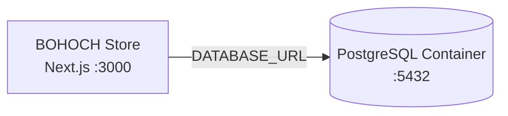

# Azure Debug Plan

> This plan is the source of truth for generating the
> VS Code debug setup in this workspace.
>
> **Status:** Implemented
> **Execution Mode:** Auto
> **Created:** 2026-10-13
> **Last Updated:** 2026-10-13

---

## Prerequisites

| Tool / Extension | Category | Service(s) | Installed | Version |
|------------------|----------|------------|-----------|---------|
| Node.js | Runtime | store | ✅ | v24.15.0 |
| npm | Package manager | store | ✅ | 11.12.1 |
| pnpm | Package manager | store | ❓ | Not detected; project uses npm |
| Prisma CLI | Migration tool | store | ✅ | 6.19.3 |
| Docker Engine | Container runtime | store | ❓ | Docker CLI 29.1.5 found; daemon is not reachable |
| Docker Compose | Compose provider | store | ✅ | v5.0.1 |
| ms-vscode.vscode-typescript-next | VS Code extension | store | ✅ | Installed in current VS Code session |
| Docker Desktop / Docker Engine | Debug container runtime | store | ❓ | Docker CLI found; Docker Desktop engine is not running |
| VS Code Node debug tooling | Debug tooling | store | ❓ | Not confirmed |
| Microsoft Edge | Browser | store | ✅ | 155.0.4283.45 |

> ⚠️ **Action required:** Start Docker Desktop before running the local PostgreSQL service. pnpm is listed in the scaffold inventory but is not used by this npm project. VS Code Node debug tooling was not confirmed.

---

## Debug Configurations

Each checked row produces a VS Code debug configuration in `.vscode/launch.json`.

| Generate | Debug Config Name | Service Label | Service Root | Project Type | Runtime | Version | Azure Dependencies |
|----------|--------------------|---------------|--------------|--------------|---------|---------|---------------------|
| [x] | BOHOCH Store (debug) | BOHOCH Store | . | frontend-spa | node-ts | 24.15.0 | PostgreSQL |

Project Type Descriptions

| Project Type | Description |
|-------------|-------------|
| frontend-spa | Next.js App Router full-stack web application with storefront pages and API route handlers |

---

## Orchestrator

| Orchestrator | Container Runtime | Compose Command | Description |
|-------------|-------------------|-----------------|-------------|
| Docker Compose | Docker | `docker compose` | Reuses the existing root `docker-compose.yml` PostgreSQL service. Docker Compose is installed, but Docker Desktop's engine was unreachable during planning. |

The existing `.env` resolves `DATABASE_URL` to a non-local database. Generated debug and migration tasks must target the local PostgreSQL service at `localhost:5432` without overwriting `.env`.

---

## Emulators

| Dependent Service | Emulator | Purpose |
|-------------------|----------|---------|
| PostgreSQL | PostgreSQL Container | Local relational database for Prisma development and migration testing; uses the existing Compose service on port 5432. |

Blob Storage is listed in the project plan but is not used by current code or dependencies; `/api/health` reports storage as `not_configured`. Azurite is therefore not included in this debug setup.

---

## Architecture Diagram

The Next.js application connects to the local PostgreSQL container for database-backed routes and migration testing.

---

## Migrations

| Generate | Service | Migration Tool |
|----------|---------|----------------|
| [x] | BOHOCH Store | Prisma (`npm run migrate`) |

---

## API Test Collections

| Generate | Service | Description |
|----------|---------|-------------|
| [x] | BOHOCH Store | 

HTTP Endpoints (10)
 GET /api/health GET /api/products GET /api/products/:slug GET /api/cart POST /api/cart/items POST /api/orders POST /api/payment/sepay/webhook GET /api/admin/inventory GET /api/admin/orders GET /api/admin/reports/overview
 |

No authentication routes are currently implemented, despite API login being listed in the project plan.

---

## Debug Configuration Checklist

- ✅ BOHOCH Store (debug) — local dev server reached the Next.js ready signal and responded with HTTP 200 from `GET http://localhost:3000/api/health` (`{"status":"ok","services":{"database":"healthy","storage":"not_configured"}}`).
- ⚠️ Local PostgreSQL emulator startup — Docker Desktop is not running in this environment, so `docker compose up -d` could not be executed here. The generated `Start Emulators` task is configured for the repo's existing compose file and should run once Docker Desktop is started.

---

## Convenience Scripts

| Generate | Script | Registered In | Description |
|----------|--------|---------------|-------------|
| [x] | emulators:start | ./package.json | Start the existing local PostgreSQL Compose service while preserving its data. |
| [x] | emulators:stop | ./package.json | Stop the PostgreSQL Compose service without deleting its data. |
| [x] | migrate | ./package.json | Apply pending Prisma migrations to the local PostgreSQL database (`npm run migrate`). |